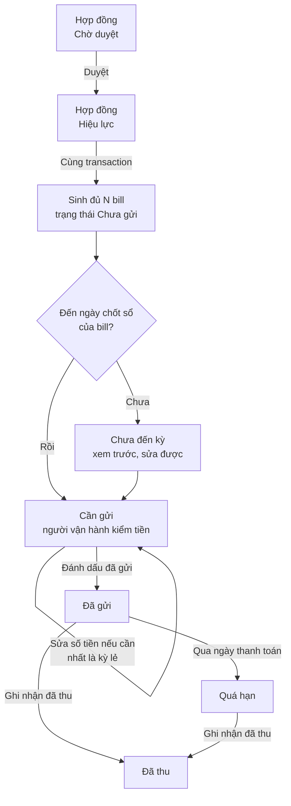
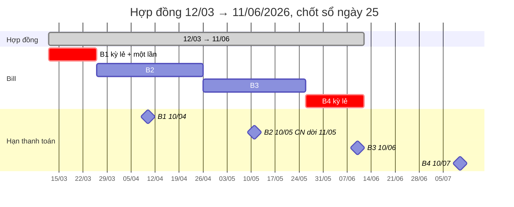
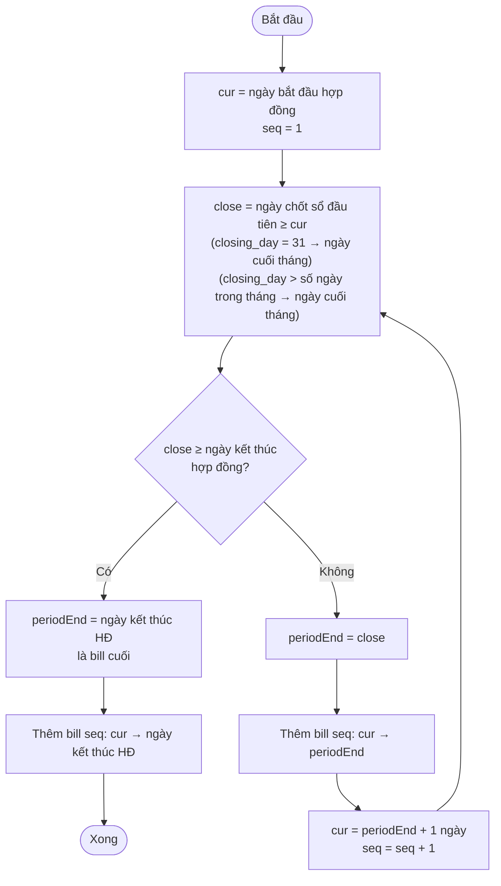
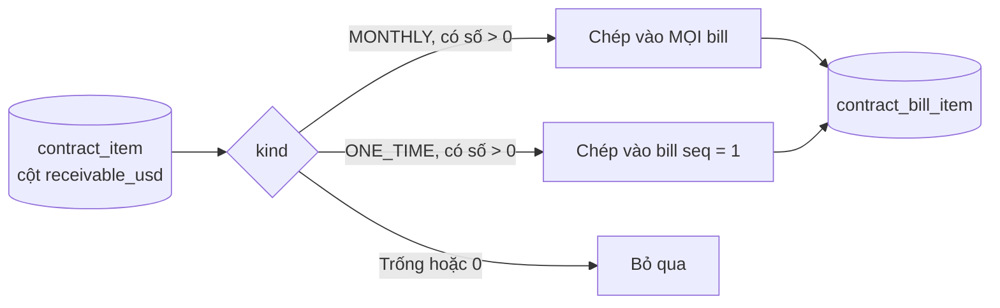
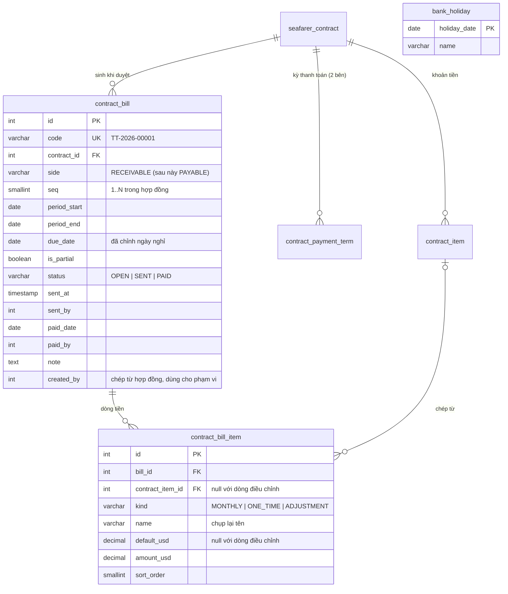
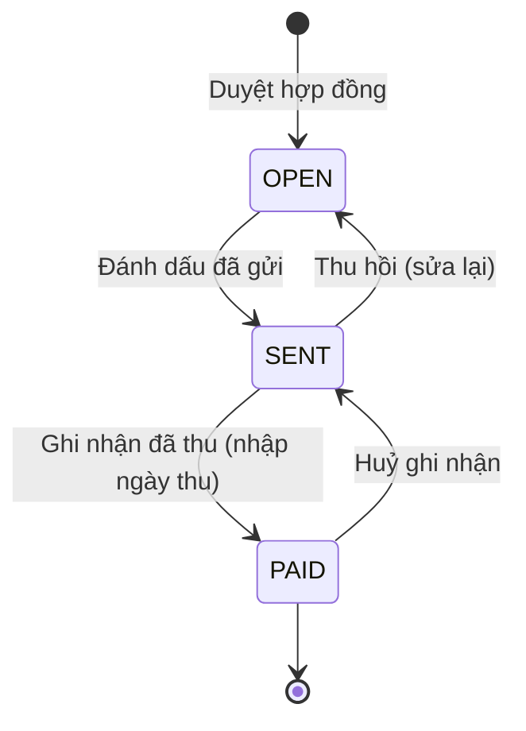
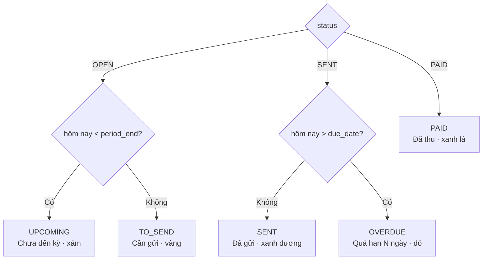
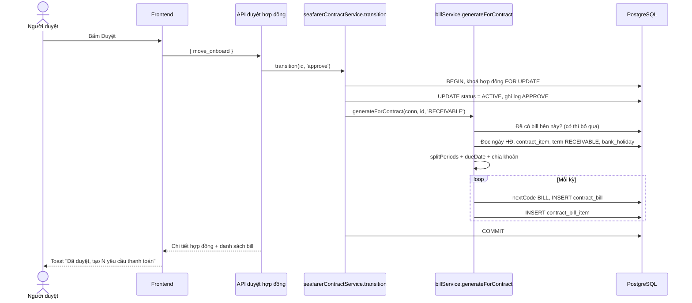

# MCAH — Thiết kế Yêu cầu thanh toán cho đối tác (bill phải thu)

- **Ngày lập:** 2026-10-21
- **Tiền đề:** đã có Chuyến tàu và Hợp đồng (`docs/mcah-ke-hoach-chuyen-tau-hop-dong.md`). Bảng `contract_item` (khoản tiền) và `contract_payment_term` (kỳ thanh toán) là đầu vào của tài liệu này.
- **Phạm vi:** chỉ bên **phải thu** (môi giới thu tiền của chủ tàu). Bên phải chi (trả thuyền viên) làm sau, dùng lại cùng bảng (mục 9).
- Sơ đồ viết bằng Mermaid. Xem trên GitHub, hoặc dán vào https://mermaid.live.
- **Wireframe:** `docs/design/wireframes/yeu-cau-thanh-toan.html` (mở bằng trình duyệt; thanh trên cùng chọn màn, phương án, trạng thái, khổ).

---

## 1. Quyết định đã chốt

| # | Quyết định | Nguồn |
|---|---|---|
| Q1 | Bill được sinh **một lần, đủ cả hợp đồng**, ngay khi hợp đồng được duyệt (`PENDING → ACTIVE`). | Người dùng |
| Q2 | Bill đầu bắt đầu đúng **ngày bắt đầu hợp đồng**. Mỗi bill kết thúc vào **ngày chốt sổ** gần nhất, hoặc vào **ngày kết thúc hợp đồng** nếu ngày đó đến trước. | Người dùng |
| Q3 | Bill sau bắt đầu ngay **ngày hôm sau** ngày kết thúc của bill trước. Không có khoảng trống, không chồng ngày. | Người dùng |
| Q4 | Kỳ lẻ (bill đầu, bill cuối ngắn hơn một kỳ) **được phép**. Hợp đồng 3 tháng có thể ra 4 bill. | Người dùng |
| Q5 | Tiền mỗi bill = **tổng khoản hằng tháng** (`MONTHLY`, cột phải thu). Kỳ lẻ **vẫn tính đủ một tháng**, không chia theo ngày. Người vận hành tự sửa tay. | Người dùng |
| Q6 | **Bill đầu** cộng thêm **tất cả khoản một lần** (`ONE_TIME`). Các bill sau không có khoản một lần. | Người dùng |
| Q7 | Ngày thanh toán của bill tính theo `pay_day`, `pay_month_offset`, `holiday_rule` của bên phải thu (mục 3.3). | Người dùng |
| Q8 | Làm bên phải thu trước. Bên phải chi làm sau. | Người dùng |
| Q9 | **Mỗi hợp đồng một bill mỗi kỳ**, không gộp nhiều thuyền viên vào một bill (đã chốt C1). | Người dùng |
| Q10 | Mọi khoản một lần, kể cả "Vé máy bay về" và "Thưởng hoàn thành hợp đồng", vào **bill đầu** (đã chốt C2). | Người dùng |

---

## 2. Tổng quan luồng



---

## 3. Quy tắc tính

### 3.1 Ví dụ chuẩn

Hợp đồng **12/03/2026 → 11/06/2026**. Kỳ phải thu: chốt sổ **ngày 25**, thanh toán **ngày 10 tháng sau**, gặp ngày nghỉ **làm sau**.



| Bill | Từ | Đến | Lý do kết thúc | Kỳ lẻ | Hạn thanh toán | Tiền mặc định |
|---|---|---|---|---|---|---|
| B1 | 12/03 | 25/03 | chốt sổ | Có (14 ngày) | 10/04 (T6) | hằng tháng + một lần |
| B2 | 26/03 | 25/04 | chốt sổ | Không | 10/05 là CN → **11/05** (T2) | hằng tháng |
| B3 | 26/04 | 25/05 | chốt sổ | Không | 10/06 (T4) | hằng tháng |
| B4 | 26/05 | 11/06 | hết hợp đồng | Có (17 ngày) | 10/07 (T6) | hằng tháng |

Cùng hợp đồng với kỳ mặc định (**chốt cuối tháng**, ngày 10 tháng sau, làm sau): B1 12/03–31/03, B2 01/04–30/04, B3 01/05–31/05, B4 01/06–11/06; hạn thanh toán giống bảng trên.

### 3.2 Chia kỳ

Hàm thuần `splitPeriods({ start, end, closingDay })`, không đọc DB, không đọc giờ máy.



**Kỳ lẻ** (`is_partial = true`) khi một trong hai đúng:
- `period_start` không phải ngày ngay sau một ngày chốt sổ (chỉ có thể xảy ra ở bill đầu);
- `period_end` không phải ngày chốt sổ (chỉ có thể xảy ra ở bill cuối).

Hợp đồng ngắn nằm gọn trong một kỳ thì chỉ có một bill, có thể lẻ cả hai đầu.

### 3.3 Ngày thanh toán

Hàm thuần `dueDate({ periodEnd, payDay, payMonthOffset, holidayRule })` (`utils/voyage_math.js`):

1. Tháng trả = tháng của `period_end` + `pay_month_offset`.
2. Ngày = `pay_day` (31 hoặc lớn hơn số ngày của tháng → ngày cuối tháng).
3. Rơi vào thứ 7, CN thì lùi (`BEFORE`) hoặc tiến (`AFTER`) tới ngày thường gần nhất.

**Không xét ngày lễ** (đã bỏ bảng `bank_holiday`, migration 014). Cần dời hạn thì người vận hành sửa ô Hạn thanh toán ở màn Sửa bill (không được trước ngày bắt đầu kỳ).

### 3.4 Tiền của bill



- Mỗi dòng bill giữ **tên chụp lại** từ hợp đồng, **số mặc định** (`default_usd`) và **số đang dùng** (`amount_usd`). Lúc sinh, hai số bằng nhau.
- Người vận hành sửa `amount_usd`. Dòng có `amount_usd ≠ default_usd` hiện chip "Đã sửa" và số mặc định gạch ngang bên cạnh.
- Người vận hành thêm được **dòng điều chỉnh** (`kind = 'ADJUSTMENT'`, tên tự đặt, số được âm, ví dụ "Trừ 16 ngày chưa làm"). Dòng điều chỉnh xoá được; dòng chép từ hợp đồng không xoá, chỉ sửa số (đặt 0 nếu không thu).
- Tổng bill = tổng `amount_usd`. Tổng không được âm.
- Sửa chỉ được khi bill **Chưa gửi**.

### 3.5 Bộ ví dụ bắt buộc có trong test

| Ca | Đầu vào | Kết quả |
|---|---|---|
| Chuẩn | 12/03/2026 → 11/06/2026, chốt 25 | 4 bill như bảng 3.1, B1 và B4 lẻ |
| Khớp kỳ | 26/03/2026 → 25/06/2026, chốt 25 | 3 bill, không bill nào lẻ |
| Bắt đầu đúng ngày chốt | 25/03/2026 → 30/04/2026, chốt 25 | B1 = 25/03–25/03 (1 ngày, lẻ), B2 26/03–25/04, B3 26/04–30/04 (lẻ) |
| Hết HĐ đúng ngày chốt | 01/04/2026 → 30/04/2026, chốt cuối tháng | 1 bill, không lẻ |
| Gọn trong một kỳ | 05/04/2026 → 20/04/2026, chốt cuối tháng | 1 bill, lẻ |
| Cuối tháng 2 | chốt cuối tháng, kỳ 01/02/2027 | period_end = 28/02/2027 |
| pay_day 31, tháng ngắn | period_end 31/01/2027, ngày 31 tháng sau | 28/02/2027 (CN) → AFTER 01/03 (T2), BEFORE 26/02 (T6) |
| Chuỗi ngày nghỉ | hạn 30/04/2026, AFTER, holiday 30/04 và 01/05 | 30/04 (lễ) → 01/05 (lễ) → 02/05 (T7) → 03/05 (CN) → **04/05** (T2) |
| Lùi qua ngày nghỉ | hạn 01/05/2026, BEFORE, holiday 30/04 và 01/05 | **29/04** (T4) |
| Khoản một lần | HĐ có FLIGHT_OUT 500, VISA_FEE trống | B1 có dòng Vé máy bay đi 500, không có dòng Phí visa; B2.. không có dòng một lần |

---

## 4. Dữ liệu

### 4.1 Sơ đồ bảng



### 4.2 Migration `backend/migrations/postgres/013_contract_bill.sql`

> Bản đã dựng khác bản nháp dưới đây ở: bỏ cột `is_partial` (không còn nhắc kỳ lẻ); `contract_bill_item` lưu `item_code` thay cho `contract_item_id`; `contract_bill` có `deleted_at` (không dùng, để kiểm phạm vi chung); thêm bảng `contract_bill_log` (CREATE, UPDATE, SEND, UNSEND, COLLECT, UNCOLLECT) cho khối Lịch sử. File migration là nguồn đúng.

```sql
-- Yêu cầu thanh toán sinh từ hợp đồng Hiệu lực. Giai đoạn này chỉ bên phải thu.

CREATE TABLE "bank_holiday" (
  "holiday_date" DATE NOT NULL PRIMARY KEY,
  "name" varchar(100) NOT NULL
);
INSERT INTO "bank_holiday" ("holiday_date", "name") VALUES
  ('2026-01-01', 'Tết Dương lịch'), ('2026-04-30', 'Giải phóng miền Nam'), ('2026-05-01', 'Quốc tế Lao động'), ('2026-09-02', 'Quốc khánh'),
  ('2027-01-01', 'Tết Dương lịch'), ('2027-04-30', 'Giải phóng miền Nam'), ('2027-05-01', 'Quốc tế Lao động'), ('2027-09-02', 'Quốc khánh');

CREATE TABLE "contract_bill" (
  "id" INTEGER GENERATED BY DEFAULT AS IDENTITY NOT NULL PRIMARY KEY,
  "code" varchar(20) NOT NULL UNIQUE,
  "contract_id" INTEGER NOT NULL REFERENCES "seafarer_contract" ("id"),
  "side" varchar(10) NOT NULL,
  "seq" SMALLINT NOT NULL,
  "period_start" DATE NOT NULL,
  "period_end" DATE NOT NULL,
  "due_date" DATE NOT NULL,
  "is_partial" BOOLEAN NOT NULL DEFAULT FALSE,
  "status" varchar(10) NOT NULL DEFAULT 'OPEN',
  "sent_at" TIMESTAMP WITHOUT TIME ZONE,
  "sent_by" INTEGER REFERENCES "user" ("id"),
  "paid_date" DATE,
  "paid_by" INTEGER REFERENCES "user" ("id"),
  "note" TEXT,
  "created_by" INTEGER,
  "updated_by" INTEGER,
  "created_at" TIMESTAMP WITHOUT TIME ZONE DEFAULT CURRENT_TIMESTAMP NOT NULL,
  "updated_at" TIMESTAMP WITHOUT TIME ZONE DEFAULT CURRENT_TIMESTAMP NOT NULL,
  UNIQUE ("contract_id", "side", "seq"),
  CONSTRAINT "contract_bill_side_check" CHECK ("side" IN ('RECEIVABLE', 'PAYABLE')),
  CONSTRAINT "contract_bill_status_check" CHECK ("status" IN ('OPEN', 'SENT', 'PAID')),
  CONSTRAINT "contract_bill_period_check" CHECK ("period_end" >= "period_start"),
  CONSTRAINT "contract_bill_sent_check" CHECK ("status" = 'OPEN' OR "sent_at" IS NOT NULL),
  CONSTRAINT "contract_bill_paid_check" CHECK ("status" <> 'PAID' OR "paid_date" IS NOT NULL)
);
CREATE TRIGGER "contract_bill_updated_at" BEFORE UPDATE ON "contract_bill" FOR EACH ROW EXECUTE FUNCTION touch_updated_at();
CREATE INDEX "contract_bill_contract_idx" ON "contract_bill" ("contract_id");
CREATE INDEX "contract_bill_due_idx" ON "contract_bill" ("status", "due_date");

CREATE TABLE "contract_bill_item" (
  "id" INTEGER GENERATED BY DEFAULT AS IDENTITY NOT NULL PRIMARY KEY,
  "bill_id" INTEGER NOT NULL REFERENCES "contract_bill" ("id") ON DELETE CASCADE,
  "contract_item_id" INTEGER REFERENCES "contract_item" ("id"),
  "kind" varchar(10) NOT NULL,
  "name" varchar(100) NOT NULL,
  "default_usd" decimal(12,2),
  "amount_usd" decimal(12,2) NOT NULL,
  "sort_order" SMALLINT NOT NULL DEFAULT 0,
  CONSTRAINT "contract_bill_item_kind_check" CHECK ("kind" IN ('MONTHLY', 'ONE_TIME', 'ADJUSTMENT')),
  CONSTRAINT "contract_bill_item_source_check" CHECK (("kind" = 'ADJUSTMENT') = ("contract_item_id" IS NULL))
);
CREATE INDEX "contract_bill_item_bill_idx" ON "contract_bill_item" ("bill_id");
```

Ghi chú:
- `contract_item` bị xoá rồi chèn lại khi sửa hợp đồng, nhưng chỉ khi hợp đồng còn Nháp / Bị từ chối, nên lúc đã có bill thì id ổn định. Dù vậy tên vẫn chụp lại vào `name` để bill không phụ thuộc hợp đồng.
- Không có `deleted_at`: bill không xoá. Hợp đồng `ACTIVE`/`ENDED` cũng không xoá được.
- `code_counter` thêm kind `BILL`; mã `TT-{năm tạo}-{5 chữ số}` qua `nextCode(conn, 'BILL', year, 'TT', 5)`.

### 4.3 Hằng số (`constants/voyage_contract.js`, bản frontend giống hệt)

```js
const BILL_STATUSES = ['OPEN', 'SENT', 'PAID']
const BILL_DISPLAY_STATUSES = ['UPCOMING', 'TO_SEND', 'SENT', 'OVERDUE', 'PAID']
const BILL_ITEM_KINDS = ['MONTHLY', 'ONE_TIME', 'ADJUSTMENT']
```

---

## 5. Trạng thái bill

### 5.1 Trạng thái lưu



| Trạng thái | Sửa dòng tiền, ghi chú | Hành động |
|---|---|---|
| `OPEN` | Được | Đánh dấu đã gửi (chỉ khi hôm nay ≥ `period_end`) |
| `SENT` | Khoá | Thu hồi, Ghi nhận đã thu |
| `PAID` | Khoá | Huỷ ghi nhận |

Gửi trước ngày chốt sổ bị chặn vì kỳ chưa khép (API trả 409 "Chưa đến ngày chốt sổ của kỳ này").

### 5.2 Trạng thái hiển thị (tính, không lưu)



"Hôm nay" lấy ở server (`CURRENT_DATE`), hàm `billDisplayStatus({ status, periodEnd, dueDate, today })` để ở `utils/voyage_math.js` và bản frontend tương ứng.

---

## 6. Sinh bill khi duyệt hợp đồng



- Sinh bill nằm **trong cùng transaction** với duyệt: lỗi ở bước sinh thì duyệt cũng không thành.
- `generateForContract` **idempotent**: đã có bill cho `(contract_id, side)` thì không làm gì. Nhờ vậy chạy lại script bù cho hợp đồng cũ (mục 8, bước 6) không sinh trùng.
- `created_by` của bill = `created_by` của hợp đồng, để phạm vi "chỉ của mình" lọc giống hợp đồng.

---

## 7. API

Quyền mới trong `constants/permissions.js`, nhóm Vận hành, `scoped: true`:

```js
{ key: 'bill', group: 'Vận hành', label: 'Yêu cầu thanh toán', scoped: true, permissions: [
  ['view', 'Xem danh sách và chi tiết'],
  ['update', 'Sửa số tiền và ghi chú', 'Chỉ khi chưa gửi'],
  ['send', 'Đánh dấu đã gửi và thu hồi'],
  ['collect', 'Ghi nhận đã thu và huỷ ghi nhận'],
] },
```

`utils/scope.js` thêm `bill: 'contract_bill'`.

| Method | Đường dẫn | Quyền | Việc |
|---|---|---|---|
| GET | `/api/v1/bills` | `bill.view` | Danh sách. Query: `tab` (all / UPCOMING / TO_SEND / SENT / OVERDUE / PAID), `search` (mã bill, số HĐ, tên thuyền viên), `ship_owner_id`, `voyage_id`, `contract_id`, `page`, `limit`. Trả `counts` theo tab và `total_usd` của tab đang xem. |
| GET | `/api/v1/bills/:id` | `bill.view` | Chi tiết: bill, dòng tiền, tóm tắt hợp đồng (số HĐ, thuyền viên, chức danh, tàu, chủ tàu, chuyến), bill trước / sau cùng hợp đồng. |
| PUT | `/api/v1/bills/:id` | `bill.update` | Body `{ items: [{ id?, kind, name, amount_usd }], note }`. Chỉ khi `OPEN`. Dòng có `id` của dòng chép từ HĐ: chỉ đổi `amount_usd`. Dòng không `id`: phải là `ADJUSTMENT`. Dòng `ADJUSTMENT` cũ không có trong body thì xoá. Tổng < 0 → 400. |
| POST | `/api/v1/bills/:id/send` | `bill.send` | `OPEN → SENT`, ghi `sent_at`, `sent_by`. Hôm nay < `period_end` → 409. |
| POST | `/api/v1/bills/:id/unsend` | `bill.send` | `SENT → OPEN`, xoá `sent_at`, `sent_by`. |
| POST | `/api/v1/bills/:id/collect` | `bill.collect` | Body `{ paid_date }` (mặc định hôm nay, không sau hôm nay). `SENT → PAID`. |
| POST | `/api/v1/bills/:id/uncollect` | `bill.collect` | `PAID → SENT`, xoá `paid_date`, `paid_by`. |

`GET /api/v1/contracts/:id` trả thêm `bills: [{ id, code, seq, period_start, period_end, due_date, is_partial, status, display_status, total_usd }]` (bên phải thu).

Mọi chuyển trạng thái dùng một bảng `TRANSITIONS` như hợp đồng, khoá dòng `FOR UPDATE`, sai trạng thái → 409 kèm nhãn trạng thái hiện tại.

---

## 8. Giao diện

Wireframe đã duyệt: `docs/design/wireframes/yeu-cau-thanh-toan.html`. Ba màn theo đúng khuôn màn Hợp đồng (danh sách, chi tiết chỉ xem, màn sửa riêng). **Không** thêm khối bill vào chi tiết hợp đồng, **không** có banner nhắc kỳ lẻ.

### 8.1 Điều hướng

Menu "Yêu cầu thanh toán" (nhóm Vận hành, sau Hợp đồng, icon `AccountBookOutlined`, quyền `bill.view`). Route: `/bills`, `/bills/:id`, `/bills/:id/edit` (quyền `bill.update`).

### 8.2 Danh sách `/bills` — `pages/admin/bills/BillListPage.jsx`

- Khuôn `ContractListPage`: thanh công cụ (tab trạng thái, ô tìm, lọc chủ tàu, lọc chuyến), bảng có cột Thao tác dính phải (Xem; Sửa chỉ khi Chưa gửi), `ListFooter` có tổng tiền của tab.
- Tab: Tất cả · Cần gửi · Quá hạn · Đã gửi · Chưa đến kỳ · Đã thu. Mặc định **Cần gửi**. Sắp theo hạn tăng dần; Tất cả và Đã thu giảm dần.
- Cột theo thứ tự: Mã (dòng phụ Kỳ i/n) · Hợp đồng (link) · Bắt đầu · Kết thúc · Đối tác (link) · Thuyền viên · Tàu (link, dòng phụ mã chuyến) · Hạn thanh toán · Số tiền · Trạng thái.
- Điện thoại: dòng thay bảng như danh sách hợp đồng.

### 8.3 Chi tiết `/bills/:id` — `BillDetailPage.jsx`

- Đầu trang: mã · kỳ, dòng phụ kỳ và hạn, badge. Nút: Chưa gửi → Sửa, Đánh dấu đã gửi (khoá tới ngày chốt sổ); Đã gửi / Quá hạn → Ghi nhận đã thu (hộp thoại chọn ngày thu), menu … Thu hồi; Đã thu → menu … Huỷ ghi nhận.
- Cột trái: Thông tin chung (hợp đồng, thuyền viên, đối tác, tàu · chuyến có link; kỳ; ngày chốt sổ; hạn thanh toán; ngày gửi; ngày thu; ghi chú), bảng tiền theo nhóm (Hằng tháng, Một lần, Điều chỉnh; bỏ nhóm trống).
- Cột phải: Số tiền (tổng và từng nhóm); **Các kỳ của hợp đồng** dạng lịch một tháng có ‹ › (`BillCalendar.jsx`): dải tô từ ngày bắt đầu tới ngày kết thúc của từng kỳ, số kỳ ở ngày bắt đầu, hạn khoanh tròn theo màu trạng thái, kỳ đang xem tô đậm, bấm kỳ khác để mở bill đó; ô tóm tắt ngày bắt đầu, kết thúc, hạn của kỳ đang xem. Không chú thích, không đánh dấu ngày lễ, không ghi "dời từ". Lịch sử (nhật ký bill).

### 8.4 Sửa `/bills/:id/edit` — `BillFormPage.jsx`

Khuôn Sửa hợp đồng: Thông tin chung (ghi chú), bảng tiền sửa được (`BillMoneyTable.jsx`: khoản hợp đồng chỉ sửa số; dòng điều chỉnh sửa tên, số âm được, xoá được, tối đa 20), thanh lưu dính đáy có tổng và từng nhóm, đếm thay đổi, Lưu khoá khi chưa đổi hoặc tổng âm. Ô đã đổi có viền màu nhấn và chip "Đã sửa". `MoneyInput` thêm prop `allowNegative`.

### 8.5 Badge (`components/ds/statusMap.js`, nhóm `bill`)

| display_status | Nhãn | Tông |
|---|---|---|
| `UPCOMING` | Chưa đến kỳ | xám, vòng |
| `TO_SEND` | Cần gửi | vàng, icon gửi |
| `SENT` | Đã gửi | xám, chấm |
| `OVERDUE` | Quá hạn N ngày | đỏ, đồng hồ |
| `PAID` | Đã thu | xanh |

## 9. Mở rộng cho bên phải chi (để sau)

Bảng đã có cột `side`. Khi làm bên phải chi:
- `generateForContract(conn, id, 'PAYABLE')` dùng term PAYABLE và cột `payable_usd`; gọi thêm trong lúc duyệt.
- Danh sách tách hai menu (Phải thu / Phải chi) hoặc một menu có bộ lọc bên; trạng thái `PAID` của bên chi đổi nhãn thành "Đã trả".
- Mã riêng, ví dụ `PC-{năm}-{5 số}`.

---

## 10. Không làm lần này, ghi lại để biết

- Bill bên phải chi (mục 9).
- Gộp nhiều thuyền viên vào một bill: không làm (C1).
- Xuất bill ra Excel / PDF, gửi email cho đối tác. "Đánh dấu đã gửi" chỉ là ghi nhận.
- Thu một phần, nhiều lần thu cho một bill.
- Quy đổi VND.
- Màn quản lý ngày nghỉ (`bank_holiday`): tạm nhập bằng SQL.
- Thuyền viên rời tàu sớm: cắt ngắn hợp đồng, huỷ / sửa các bill sau (giai đoạn 3).
- Thông báo nhắc bill cần gửi / quá hạn.

## 11. Câu hỏi đã chốt

- **C1.** Mỗi hợp đồng một bill mỗi kỳ, như thiết kế (Q9).
- **C2.** Khoản một lần, kể cả vé về và thưởng hoàn thành, vào bill đầu (Q10).

---

## 12. Các bước dựng

Mỗi bước một commit, chạy lint và test phần vừa sửa trước khi commit. Nhánh `feature/yeu-cau-thanh-toan`.

| Bước | Việc | Xong khi |
|---|---|---|
| 1 | Migration `013_contract_bill.sql` | Chạy sạch trên DB trống và DB hiện có |
| 2 | Hàm thuần `splitPeriods`, `dueDate`, `billDisplayStatus` ở `utils/voyage_math.js` + bản frontend | Đủ bộ ví dụ 3.5 trong test, backend và frontend cho cùng kết quả |
| 3 | `services/contract_bill.service.js`: `generateForContract`, `list`, `get`, `update`, `transition`; gọi sinh bill trong `approve` | Test service: duyệt sinh đúng số bill, gọi lại không trùng, sửa / chuyển trạng thái đúng bảng 5.1 |
| 4 | Quyền `bill.*`, `scope.js`, routes `/api/v1/bills`, `bills` trong chi tiết hợp đồng | Test route: thiếu quyền 403, ngoài phạm vi 404 |
| 5 | Frontend: `billApi.js`, nav, danh sách, chi tiết, panel trên chi tiết hợp đồng, badge | Dùng thử trên app: duyệt HĐ mẫu 3.1 ra 4 bill, sửa tiền B1, gửi, ghi nhận thu |
| 6 | Script `backend/scripts/backfill_contract_bills.js` sinh bill cho hợp đồng đang `ACTIVE` / `ENDED` | Chạy hai lần không sinh trùng |

## 13. Nhật ký

| Ngày | Bước | Commit | Ghi chú |
|---|---|---|---|
| 2026-10-21 | — | — | Lập thiết kế |
| 2026-10-21 | — | — | Chốt C1, C2; vẽ wireframe `docs/design/wireframes/yeu-cau-thanh-toan.html` |
| 2026-10-22 | 1–6 | chưa commit | Dựng xong trên nhánh `feature/yeu-cau-thanh-toan`: migration 013, hàm tính, service, API `/bills`, quyền `bill.*`, sinh bill khi duyệt, 3 màn, script bù `backend/scripts/backfill_contract_bills.js` (đã chạy trên DB local: 9 hợp đồng, 75 bill) |
| 2026-10-22 | — | chưa commit | Bỏ né ngày lễ (migration 014 xoá `bank_holiday`); hạn thanh toán sửa tay được ở màn Sửa bill |
